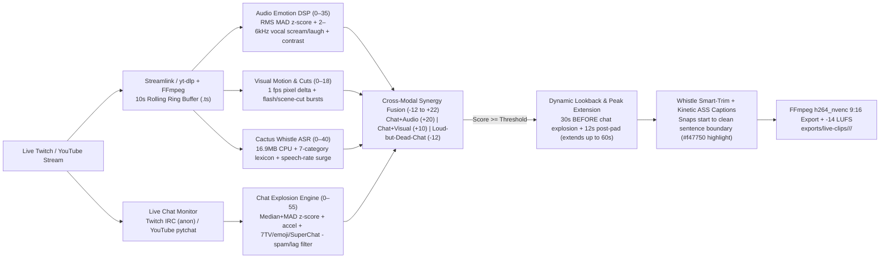

# Live Stream Viral Clipper Agent Workflow (v2 — Multimodal Model)

Autonomous real-time highlight detector & vertical Shorts clipper for **Twitch** and **YouTube Live** streams (plus offline VOD/local video scanning). Engineered around the **chat-latency lookback** principle used by viral clip channels: because viewers see a moment 4–8s late and react 2–4s after that, chat explosions trigger a **30-second lookback** (`--chat-pre-pad 30`) so every clip opens on the buildup, rides the climax, and catches the reaction.

---

## Multimodal Virality Model (v2)



---

## 1. Tuning Signals & Keywords Without Touching Code

Edit **[config/clipper-signals.json](config/clipper-signals.json)** to customize:
- **7 weighted transcript categories:** `explicit_clip_calls`, `disbelief_shock`, `hype_clutch_victory`, `comedy_fail_rage`, `story_drama_hot_take`, `gaming_news_reveals`, `audience_hooks` (140+ phrases built in).
- **Chat hype lexicon:** 7TV/BTTV/Twitch emotes (`KEKW`, `ICANT`, `AINTNOWAY`, `POGU`, `PAGMAN`, `COOKED`, `CINEMA`, `AURA`), emojis (`💀😭🔥😂😱`), ALL-CAPS & elongated words (`NOOOOO`, `WWWWWW`), plus YouTube SuperChat boosts.
- **False-positive dampers:** Filters single-user spam (unique-chatter diversity check) and down-weights tech complaints (`"lag"`, `"mic muted"`, `"buffering"`, `"ads"`).

---

## 2. Commands

### Watch a Live Twitch Stream (30s Pre-Chat-Explosion Lookback + IRC + Whistle + NVENC)
```bash
.venv/bin/python orchestration/live_clipper_agent.py \
  --url "https://www.twitch.tv/<channel_name>" \
  --keywords "gta 6,trailer,clutch,glitch" \
  --threshold 52 \
  --chat-pre-pad 30 --post-pad 12 \
  --layout split-blur
```

### Watch a Live YouTube Stream (Live YouTube Chat + SuperChats + Whistle + NVENC)
```bash
.venv/bin/python orchestration/live_clipper_agent.py \
  --url "https://www.youtube.com/watch?v=<LIVE_VIDEO_ID>" \
  --name "youtube-live" \
  --keywords "gta,gameplay,reveal" \
  --threshold 52 \
  --chat-pre-pad 30 --post-pad 12 \
  --layout split-blur
```

### Scan an Existing VOD / Local Recording Offline
```bash
.venv/bin/python orchestration/live_clipper_agent.py \
  --input path/to/recording.mp4 \
  --keywords "insane,no way,clutch" \
  --threshold 38 \
  --max-clips 5
```

### Key Flags
| Flag | Default | Purpose |
| :--- | :--- | :--- |
| `--chat-pre-pad` | `30` | Seconds **before** a chat explosion to start the clip (covers 5–10s stream/human lag + 20s buildup) |
| `--audio-pre-pad` | `20` | Seconds **before** an audio/speech-only trigger to start the clip |
| `--post-pad` | `12` | Seconds **after** peak to capture streamer & chat reaction |
| `--max-clip-sec` | `60` | Ceiling when Dynamic Peak Extension rides an escalating moment |
| `--threshold` | `52` | Trigger threshold (`0–100`). Clips are graded `S-TIER` (≥82), `A-TIER` (≥65), or `B-TIER` |
| `--layout` | `split-blur` | `split-blur` (9:16 ambient blur + crisp foreground), `crop` (9:16 center crop), or `landscape` (16:9) |
| `--buffer-minutes` | `10` | Max rolling `.ts` buffer kept on disk (older chunks auto-pruned) |

---

## 3. Compliance & Review Output

Every detected moment exports to `exports/live-clips/<channel>/<clip_id>/`:
- `<clip_id>.mp4` — 9:16 NVENC video with smart-trimmed opening hook, Whistle word-level kinetic captions, and `-14 LUFS` audio
- `moment.json` — Full multimodal score breakdown (`S-TIER` / `A-TIER` / `B-TIER`, archetype, synergy reasons, chat spike ratio)
- `captions.ass` & `transcript.json` — Exact aligned word timestamps
- `metadata.md` — Draft title + `hookscore.py` evaluation + stream source attribution + AI disclosure
- `checklist.md` — **Rule 4 (Human Approval Gate)** & **Rule 5 (Clip Rights Clearance)** — never uploads autonomously
