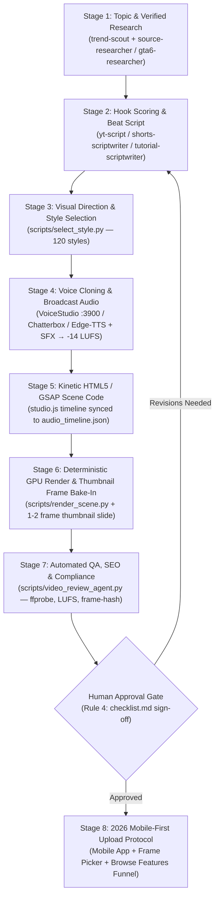

# CreatorRadar — AI Video-by-Code Production Workflow

This document is the end-to-end operational workflow for producing YouTube Shorts (`9:16`) and long-form explainers (`16:9`) via code in this workspace, plus the exact checklist for installing any pending local AI tools and model weights.

---

## 0. Pre-Flight Check (Run Before Any Session)

Verify hardware, encoders, services, and pending installs in one command:

```bash
.venv/bin/python scripts/studio_doctor.py
```

---

## 1. Pending Installs & Downloads (One-Time Setup)

> **Disk Space Note:** Check `df -h .` before installing optional GPU engines. Each PyTorch CUDA environment + HuggingFace checkpoint uses ~5–8 GB.

### A. VoiceStudio Cloned Voice (Recommended First — PyTorch CUDA Already Installed)
1. Start the Studio UI + API + VoiceStudio CUDA backend:
   ```bash
   ./scripts/start_studio.sh --with-voicestudio
   ```
2. Open `http://localhost:3000` → **Voice Studio** tab (or VoiceStudio directly at `http://127.0.0.1:3900`).
3. Enroll `assets/voices/creator_sample.wav` as profile `creator_default`.
4. Trigger one test synthesis — VoiceStudio will automatically download its active TTS model weights (~1.5–4 GB) into the local cache.
5. Verify online status:
   ```bash
   .venv/bin/python scripts/voice_studio_client.py --health
   ```

### B. Chatterbox TTS (Optional Local Zero-Shot Voice Cloning)
`external/chatterbox/.venv` exists but has no packages installed yet.
```bash
# 1. Authenticate with HuggingFace (required for Chatterbox-Turbo weights)
export HF_TOKEN="hf_your_token_here"

# 2. Install PyTorch CUDA + Chatterbox inside its isolated venv
uv pip install --python external/chatterbox/.venv/bin/python \
  torch==2.6.0 torchaudio==2.6.0 --index-url https://download.pytorch.org/whl/cu124
uv pip install --python external/chatterbox/.venv/bin/python -e external/chatterbox

# 3. Smoke test (downloads model weights ~2-4 GB on first run)
.venv/bin/python scripts/chatterbox_tts.py \
  "Testing CreatorRadar local voice cloning." /tmp/cb_test.wav
```

### C. TangoFlux (Optional Local AI Sound Effects Generator)
`external/TangoFlux/.venv` exists but has no packages installed yet.
```bash
uv pip install --python external/TangoFlux/.venv/bin/python \
  torch==2.4.0 torchaudio==2.4.0 torchvision==0.19.0 --index-url https://download.pytorch.org/whl/cu124
uv pip install --python external/TangoFlux/.venv/bin/python -r external/TangoFlux/requirements.txt
uv pip install --python external/TangoFlux/.venv/bin/python -e external/TangoFlux

# Smoke test (downloads declare-lab/TangoFlux ~3-5 GB on first run)
.venv/bin/python scripts/tangoflux_sfx.py \
  "Deep cinematic bass boom and metallic whoosh" assets/sfx/boom_whoosh.wav --duration 3
```

### D. HyperFrames CLI / Studio (Optional Advanced HTML5 Renderer)
`scripts/render_scene.py` already renders `studio.js` + GSAP scenes via Google Chrome + NVENC. Only build `external/hyperframes` if you want the HyperFrames preview studio, shader transitions, or CLI:
```bash
cd external/hyperframes
bun install
bun run build
```

### E. Lemo-Opuscar Full Audio/Film Engine (Optional)
Style tokens are already available in `styles/lemo/`. Install Lemo-Opuscar dependencies only if you plan to run its standalone film pipeline:
```bash
sh external/lemo-opuscar/plugin/skills/lemo-opuscar/scripts/setup.sh deps
# Optional offline Kokoro voice & music tiers:
sh external/lemo-opuscar/plugin/skills/lemo-opuscar/scripts/setup.sh deps voice
sh external/lemo-opuscar/plugin/skills/lemo-opuscar/scripts/setup.sh deps music
```

### F. Governance & Media Assets (Optional Hygiene)
- Fill in channel font & brand palette in `config/production-rules.md` (Section 8).
- Add royalty-free background music beds (e.g., YouTube Audio Library) under `assets/music/`.
- Maintain copyright clearance records in `assets/clearance-log.md`.

---

## 2. End-to-End Video-by-Code Production Workflow



### Mode 1 — One-Command Autonomous Pipeline (Fastest)

#### Produce a Vertical YouTube Short (`1080x1920`, 9:16)
```bash
# Auto-selects optimal style from 120 styles
.venv/bin/python orchestration/multi_agent_studio.py "Your Video Topic Here"
```

#### Produce a Landscape Explainer (`1920x1080`, 16:9) with Custom Script & Style
```bash
.venv/bin/python orchestration/multi_agent_studio.py \
  --topic "Why Local AI Workflows Beat Cloud Subscriptions" \
  --format long \
  --style swiss-kinetic \
  --script projects/my-topic/script.md
```

**Output structure created automatically:**
- `renders/<slug>/script.md` — structured beat script
- `renders/<slug>/beats.json` & `audio_timeline.json` — exact per-beat start/end timestamps
- `renders/<slug>/narration_master.wav` — `-14 LUFS` mastered voiceover + beat-synced SFX
- `renders/<slug>/scene/index.html` — deterministic HTML5/GSAP kinetic composition
- `renders/<slug>/visual_raw.mp4` — GPU-encoded (`h264_nvenc`) video track
- `exports/<slug>/YYYYMMDD-<slug>.mp4` — final muxed deliverable
- `exports/<slug>/metadata.md` — SEO title, description, tags, official sources, mandatory AI disclosure
- `exports/<slug>/REVIEW.md` & `review.json` — automated technical, loudness & motion audit
- `exports/<slug>/checklist.md` — Rule 4 human approval gate (must be checked manually before upload)

---

### Mode 2 — Step-by-Step Modular Code Workflow (Full Creative Control)

Use this when you want to write bespoke HTML5/GSAP/Canvas scenes, custom scripts, or swap voice/SFX engines manually.

#### Step 1: Research & Fact Ledger
- Save verified claims with URLs and access dates in `research/<slug>/claims.md`.
- For GTA VI topics, cite only approved official sources in `config/gta6-sources.md` (Rules 1–3).

#### Step 2: Script & Hook Scoring
- Draft beat-structured script in `projects/<slug>/script.md` using `## Beat N: Title` headings.
- Score candidate hooks:
  ```bash
  .venv/bin/python skills/yt-script/hookscore.py "Your opening hook line"
  ```
- Lint title + thumbnail pairing:
  ```bash
  .venv/bin/python skills/yt-package/title.py "Your Video Title"
  ```

#### Step 3: Select Visual Style & Tokens
```bash
.venv/bin/python scripts/select_style.py --topic "Your Topic" --format short
```

#### Step 4: Generate Synced Broadcast Audio (`-14 LUFS` + SFX)
- Option A — Per-beat synced audio via VoiceStudio (falls back to Edge-TTS if `:3900` is offline):
  ```bash
  .venv/bin/python scripts/generate_broadcast_audio.py \
    renders/<slug>/beats.json \
    renders/<slug>/narration_master.wav
  ```
- Option B — Generate custom SFX with TangoFlux (once installed) and save into `assets/sfx/`:
  ```bash
  .venv/bin/python scripts/tangoflux_sfx.py "Crisp UI glitch pop" assets/sfx/glitch_pop.wav --duration 2
  ```

#### Step 5: Author or Customize the Kinetic Scene
- Edit `renders/<slug>/scene/index.html` (powered by `scripts/studio.js` + GSAP).
- Ensure **Rule 7** compliance: continuous micro-motion (Ken Burns `1.0x -> 1.08x`), transition flashes/cuts, high-contrast typography, and word-by-word synced captions driven by `audio_timeline.json`.

#### Step 6: Deterministic Render via Chrome + NVIDIA NVENC
```bash
.venv/bin/python scripts/render_scene.py \
  renders/<slug>/scene \
  renders/<slug>/visual_raw.mp4 \
  --fps 30 --quality high --codec auto
```
Mux rendered video with mastered audio:
```bash
ffmpeg -y -i renders/<slug>/visual_raw.mp4 -i renders/<slug>/narration_master.wav \
  -c:v copy -c:a aac -b:a 192k -shortest -movflags +faststart \
  exports/<slug>/$(date +%Y%m%d)-<slug>.mp4
```

#### Step 7: Automated QA Audit & Human Sign-Off
```bash
.venv/bin/python scripts/video_review_agent.py \
  exports/<slug>/$(date +%Y%m%d)-<slug>.mp4
```
1. Inspect `exports/<slug>/REVIEW.md` and the extracted beat frames in `exports/<slug>/review_samples/`.
2. Or visually review & sign off in the Studio UI (`./scripts/start_studio.sh` → `http://localhost:3000` → **Exports & QA** tab).
3. **Rule 4:** Only upload after reviewing `checklist.md` and `metadata.md` (including the mandatory AI disclosure line).

#### Step 8: The 2026 Million-View Mobile Upload Protocol (Browse Features Funnel)
To break out of the standard Shorts Feed cliff and unlock high-converting **YouTube Browse Features (Homepage)**:

1. **Inject 1-Frame Custom Thumbnail Card:**
   Ensure the high-contrast thumbnail card is baked directly into the video timeline (for 1–2 frames at `t=0` or the tail).
2. **Transfer to Mobile Device:**
   Transfer the export MP4 (`exports/<slug>/YYYYMMDD-<slug>.mp4`) to iOS/Android via Google Drive, AirDrop, or local transfer.
3. **Upload via YouTube Mobile App:**
   - Tap `+` > **Create a Short** > select the MP4.
   - Tap the **Pencil Icon** on the video preview.
   - Scrub playhead to the custom thumbnail frame and confirm. *(This feature is locked out on desktop YouTube Studio).*
4. **Curiosity & Reverse-Psychology Metadata:**
   - Title: Use an **End-Payoff Hook** (*"What happens at the 28-second mark is wild"*) or **Reverse Psychology** (*"Don't click the audio"*) under 55 characters.
   - Hashtags: Strictly **3–5 niche hashtags** (e.g., `#Shorts #GTA6 #Gaming`). Never exceed 15 (over 60 tags triggers YouTube's automated spam de-indexing).
   - Category: Ensure the explicit Video Category (e.g., *Gaming* or *Science & Technology*) is chosen.
5. **Stage as UNLISTED & Timed Release:**
   - Set initial visibility to **Unlisted** (never Private) so YouTube's automated Content ID and HD 1080p60 encoding complete fully before public impressions.
   - Check **YouTube Analytics > Audience** for your channel's peak viewer activity window.
   - Schedule or publish **60 minutes before peak viewer activity** to build momentum.
6. **Attach Related Video Link:**
   - In YouTube Studio, attach a flagship long-form video or episodic Short under **Related Video** to route Shorts swipers into a channel binge loop.

---

### Mode 3 — Browser Control Center (Visual Studio UI)

```bash
# Without VoiceStudio (uses Edge-TTS fallback)
./scripts/start_studio.sh

# With local CUDA VoiceStudio voice cloning
./scripts/start_studio.sh --with-voicestudio
```
- **Studio UI:** `http://localhost:3000` (launch production waves, manage `dashboard/ideas-queue.md`, browse all 120 styles, record voice samples, inspect QA filmstrips, and run Hook Scorer / Title Linter).
- **Studio Engine API:** `http://127.0.0.1:8080`
- **VoiceStudio API:** `http://127.0.0.1:3900`

---

## 3. Live Stream Auto-Clipper (Twitch & YouTube Live)

For real-time stream monitoring, automatic highlight clipping, and word-level kinetic captions powered by **Cactus-Compute/whistle (16.9 MB)** + **Streamlink** + **NVENC**, see **[LIVE_CLIPPER_WORKFLOW.md](LIVE_CLIPPER_WORKFLOW.md)** and run `orchestration/live_clipper_agent.py`.

---

## 4. Performance Diagnostic Matrix (Troubleshooting View Ceilings)

When Shorts stall, consult this algorithmic diagnostic table to pinpoint the exact failure mode and execute the corrective protocol:

| View Ceiling | Root Cause Diagnosis | Failure Mechanism | Studio Corrective Protocol |
| :--- | :--- | :--- | :--- |
| **0 Views ("0-View Jail")** | Account trust flag / Bot detection | YouTube's anti-bot system flagged a new IP/account; phone verification or advanced features missing. | **Organic Warm-up:** Stop automated posting for 3–5 days. Watch, like, and comment from the creator Google account organically. Verify 2FA and phone verification in YouTube Studio settings. |
| **100 – 3,000 Views ("Feed Jail")** | Hook or retention drop-off | First 3 seconds failed to capture swipers (Viewed vs Swiped < 75%), or pacing sagged mid-video. | **Creative Re-Hooking:** Re-author the first 2 seconds. Cut all pre-speech silence, start narration at $\le 0.05$s, inject high-contrast motion proof, and insert a secondary twist at $t=12$s to drive APV $>100\%$. |
| **~30,000 Views ("Shorts Feed Plateau")** | Zero Browse Features penetration | Content performs decently in the Shorts feed, but has no click pull on YouTube Home/Browse. | **Browse Optimization:** Deploy high-contrast 1-frame custom thumbnail via mobile upload; rewrite title with curiosity/reverse-psychology hooks; attach an authoritative Related Video link. |

